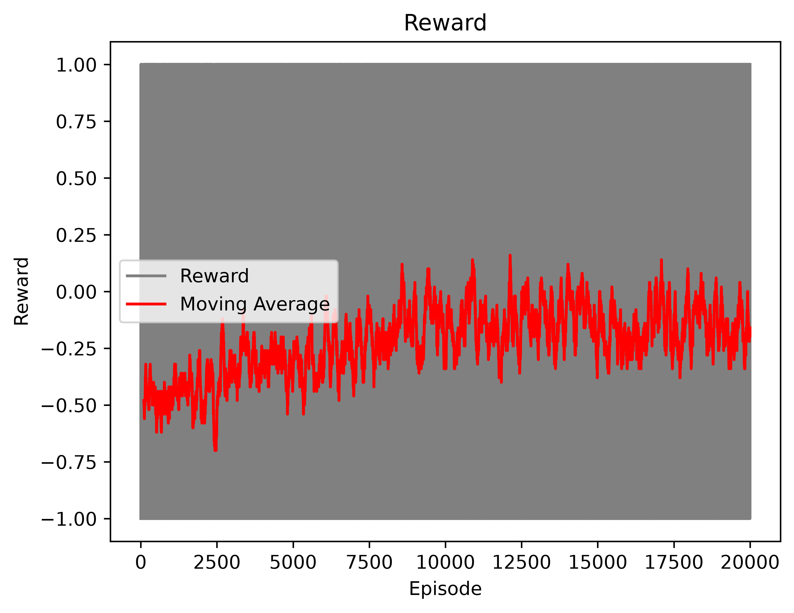
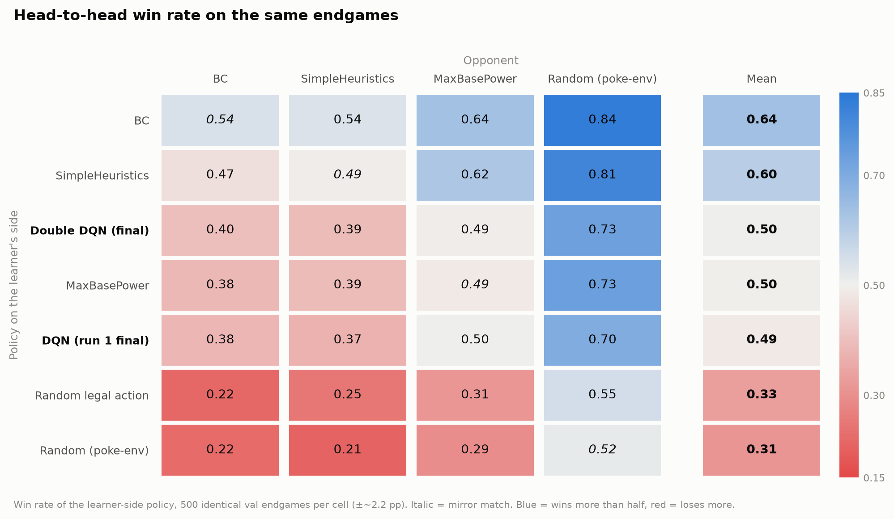

# ECE1508Project

- We train RL agents to play 2v2 Pokemon endgames: each side has 2 non-fainted Pokemon left, both on the field, so no switching.

- Basic pokemon rules:
    - Pokemon is a turn taking game with 2 players. Each players takes turns selecting moves for both of their pokemon, which can target any of the 3 other pokemon on the field. 
    - Move order is resolved by speed (faster pokemon move first). 
    - Move strength is resolve by pokemon stats (attack, special attack) and targeted pokemon defense (hp, defense, special defense). 
    - Damage is also multiplied/divided by typing (water does 2x damage to fire types, fire does 0.5x to water types). See this chart for all type relationships: https://pokemondb.net/type
    - There are setup moves (double your teamate or your own speed/damage/defense, etc), reverse turn order (trick room).
    - There is a gimmick, called mega evolution. Mega evolution gives your pokemon new abilities and increases its stats. Can be used once per battle on only 1 pokemon.
    - Pokemon hold items, that have special abilities (e.g. 1.25x damage, heal 25% health, etc).
    - You lose if all your pokemon feint.

- Pipeline: collect endgame checkpoints from vgc-bench agents → wrap them in a gym env (`endgame_env`) → train and evaluate a DQN (`dqn`).

- Everything runs from `ECE1508Project/` with the `VGC_env` venv. vgc-bench must be checked out next to this repo at `../vgc-bench`. If it's somewhere else, set `VGC_BENCH_ROOT`.

## 1. Data collection

- vgc-bench agents (BC, SimpleHeuristics, MaxBasePower, Random) play each other on a local Showdown sim. The first time a game reaches a 2v2, we save a checkpoint (seed, teams, agents, input log) and stop the game.

```bash
VGC_env/bin/python src/data_extraction_and_analysis/collect_endgames.py \
    --n_checkpoints 20000 --reg ma --num_teams 4 --out_dir <DATA_DIR>
```

- The checkpoints are written to `<DATA_DIR>/endgames.jsonl`. Running it again with the same `--out_dir` resumes the run.

- Useful flags: `--pool bc=0.35,sh=0.35,mbp=0.2,random=0.1` (the agent weights; each side draws its agent independently), `--max_turns`, `--seed`.

- **Time:** `reg_ma_4teams` has 20,005 checkpoints from about 65k battles. Only about 30% of battles reach a 2v2. Expect roughly **5 hours** for this size on one process (WSL2, CPU only), plus about 1.5 min of startup. The process needs about 1.1 GB RAM.

- The existing dataset is in `data/endgames/reg_ma_4teams/endgames.jsonl.gz`. The env only reads uncompressed `*.jsonl`, so unzip it first:

```bash
mkdir -p <DATA_DIR>
gunzip -c data/endgames/reg_ma_4teams/endgames.jsonl.gz > <DATA_DIR>/endgames.jsonl
```

## 2. Endgame env

- `src/endgame_env/endgame_env.py`: `EndgameEnv`, a gymnasium env. `reset()` restores a random checkpoint with fresh sim randomness. The learner plays one side and the opponent is the agent that originally played the other side.

- No Showdown server is needed. The env starts a `SimBridge` (from `local_sim.py`), which launches `sim_bridge.js` in Node and talks to it over stdin/stdout pipes. Battles run fully locally.

- `src/endgame_env/encoding.py`: called by the env on every `reset()` and `step()`.
    - `encode_obs(battle)` → state vector
    - `legal_actions(battle, spec)` → action mask
    - `decode(action, ...)` → poke-env order sent to the sim

- **State (2,170 floats):** vgc-bench's `PolicyPlayer` embedding.
    - 0–27: global (weather, terrain)
    - 28–56: our side conditions (tailwind, screens, ...); 57–85: same for the opponent
    - 86–2169: 4 × 521 per active Pokémon (ours a/b, then theirs a/b): ability, item, moves, stats, types, HP, status, boosts, ...

- **Action (625 discrete):** a joint action for both slots, 25 × 25.
    - Per slot, 25 options: pass, or 4 moves × 3 targets (foe a, foe b, ally) × with/without mega.
    - `info["action_mask"]` marks the legal ones (PP, choice lock, taunt, fainted targets, ...).
    - With `ally_targets=False` it drops to 17 per slot, or 289 joint actions.

- **Reward:** +1 win, −1 loss at the end. Optional `hp_shaping=λ` adds `λ × Δ(own HP − opp HP)` per step. Episodes truncate after 30 turns.

Example (run from `ECE1508Project/`):

```python
import sys
sys.path.insert(0, "src/endgame_env")
import numpy as np
from endgame_env import EndgameEnv

env = EndgameEnv("<DATA_DIR>", split="train")  
obs, info = env.reset(seed=0)

done = False
while not done:
    legal = np.flatnonzero(info["action_mask"])
    action = np.random.choice(legal)  # your policy here
    print(env.describe_action(action))  # e.g. [a: move1->foe b | b: move3->foe a]
    obs, reward, terminated, truncated, info = env.step(action)
    done = terminated or truncated

print("won" if info["won"] else "lost", reward)
env.close()
```

- `split="train"` / `"val"`: a fixed 5% of checkpoints (by id hash) is held out for val.
- Put `opponent={"name": "sh"}` in the EndgameEnv instantiation to choose the opponent.
- `reset(options={"index": i, "side": "p1"})` picks a specific scenario.

## 3. DQN

- Each run saves `final_weights.pth`, `ckpt_<episode>.pth` every 1k episodes, `rewards.npy`/`losses.npy` and the plots in `--run_dir`.

```bash
# train (Double DQN)
VGC_env/bin/python src/dqn/main.py --data <DATA_DIR> --double_dqn --run_dir <RUN_DIR>

# evaluate DQN greedily on the 500 val scenarios
VGC_env/bin/python src/dqn/main.py --play --data <DATA_DIR> --run_dir <RUN_DIR>

# head-to-head: every policy vs every opponent on the same 500 val endgames
VGC_env/bin/python src/dqn/eval_matrix.py --data <DATA_DIR> \
    --learners <RUN_DIR>/final_weights.pth random_policy random mbp sh bc \
    --figure docs/figures/head_to_head_reg_ma_4teams.png
```

- **Time:** about 52 min for 20k episodes on 1 CPU core.
### Double DQN: reward vs episode

The red line is the moving average of the ±1 episode reward. It rises from about −0.5 to about −0.15 (a win rate of about 42%) and plateaus after about 10k episodes.



### Head-to-head on the same 500 val endgames

Rows are the policy on the learner's side and columns are the opponent. The DQN plays at about MaxBasePower level: well above random, below SimpleHeuristics and BC.


